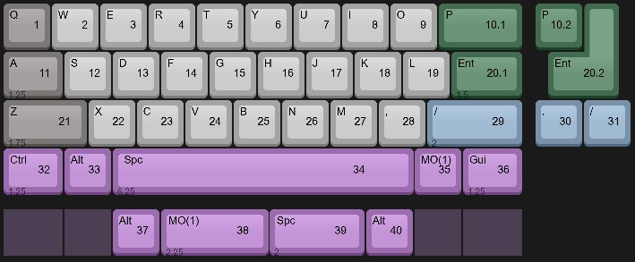
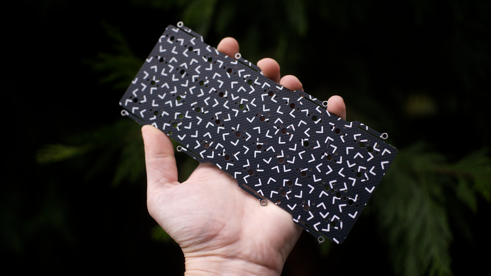
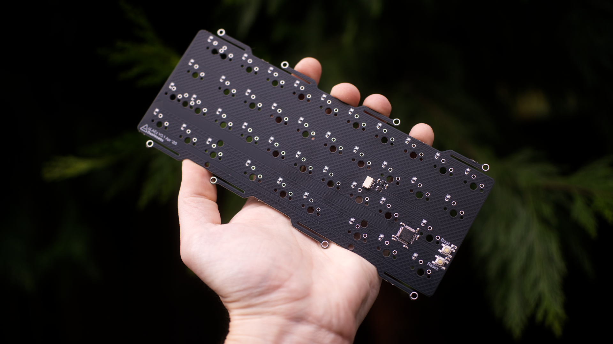
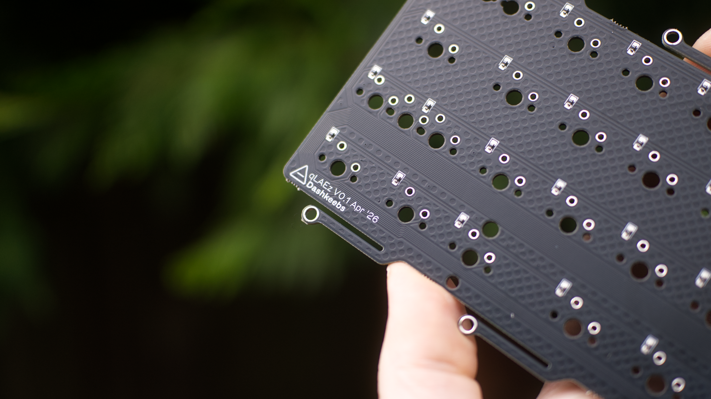

# **qLAEz**

qLAEz is an STM32 10.75u PCB with leaf spring tadpole mounting

The goal of this PCB is to have a basic in stock QAZ PCB with LAE support

I made this layout and then realized it was very similar to [Mike's](https://keyboardarcade.xyz/), the owner of the [40s Discord](https://discord.com/invite/40percent), Ziggy. I got a blessing from him to list on Dashkeebs for sale!

### Of note: I'm being a bit cheeky and I am doing forced stabless on all 2u and up keys less the 6.25u spacebar

### In this repo you will find:
```
- Layout options
- Images of PCB
- Firmware
- STEP model of PCB
- Edgecuts
```

VIAL firmware commissioned by [Moinboards.](https://moinboards.de/) Thank you again so much!

### KLC layout

[Link to KLC layout](https://keyboard-layout-creator.com/layout/cmld2yzlt000yph01eywqw339)

### PCB images



